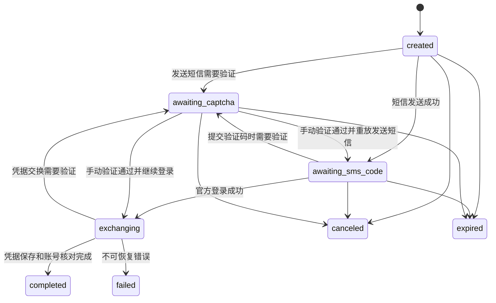

# 后端设计 v0.2.0

2026-10-26更新：游戏签到福利已接入原执行器、每日计划、去重、奖励记录与人工验证恢复。新增Games服务、game_sign任务和两个角色查询操作，共40个HTTP操作。具体契约、真实实测范围和前端流程见 [签到福利接入说明](game-checkin.md)。下文2026-10-23部分保留为初版设计背景。

本文件描述目标实现，不代表功能已经实现。机器可读 HTTP 契约以 [openapi.json](openapi.json) 为准，官方接口事实以 [验证记录](../接口验证记录.md) 为准。

2026-10-23实施补充：后端首版已落地，运行说明见 [backend/README.md](../backend/README.md)。当前使用Node内置SQLite和Argon2id；为保持单机项目简单，业务记录由有版本的JSON documents表存储，管理员、会话、加密账号、每日领取记录、限流和幂等记录保留专用表与唯一约束。表格中更细的拆表属于后续演进，不是当前数据库结构。HTTP契约保持v0.1.0。

人工验证renew只创建新的本地Challenge，不在后台偷偷重发短信或延长官方session窗口；已过期会话返回410，须重新开始原操作。周期健康检查每6小时一次，自动恢复失败后有退避，要求重新登录或等待验证的账号不循环重试。真实上游与前端联合验收仍待完成。

## 1. 产品范围

一个自托管实例对应一个管理员，管理多个获授权的米游社账号。开源源码供各人自行部署；不做公众注册、多租户、用户邀请或收费系统。

目标包含管理员认证、短信添加账号、人机验证、多账号管理、任务与余额查询、手动与定时执行、凭据状态检查、工作 Cookie 更新、运行记录、失败通知和备份恢复说明。

功能是否可执行由后端能力目录决定。完整页面和流程必须实现，但未经验证的上游能力不能伪装成已支持：

| 能力 | 当前证据 | 首版策略 |
| --- | --- | --- |
| 短信登录、工作 Cookie 换取 | 新设备单账号实测通过 | 核心功能 |
| 登录人机验证 | 用户手动极验 v4 实测通过 | 核心功能；接口保留 v3 结果类型 |
| 原神社区签到 | 成功、到账、重复执行均通过 | 首个可执行适配器 |
| 其他社区签到 | 未实测 | 放入能力目录，验证后启用 |
| 独立领奖 | 本次签到自动到账，未测试独立领取 | 适配器验证前不可执行 |
| 浏览、点赞、分享 | 未验证，任务规则可能变化 | 目录与执行模型预留；验证后由管理员逐项启用 |
| 游戏奖励签到 | 原神、星穹铁道、绝区零单账号真实签到通过 | v0.2已实现；按角色独立执行，见接入说明 |
| 评论、发帖、商品兑换 | 不在本项目范围 | 本版不执行，不展示成可用能力 |
| 根 stoken 自动续期 | 旧候选接口返回 -5300 | 不作可用承诺；支持重新登录恢复 |

“米游币任务”以当日任务定义为准，不能硬编码固定每日收益。用户没有第二个账号，真实多账号隔离验收暂缺条件，但隔离逻辑须通过虚构凭据测试。

## 2. 技术方案与目录边界

选择 TypeScript、Node.js 24 LTS、Fastify 5 和 SQLite。使用版本化 SQL 迁移与单一数据库访问层，先不引入 ORM。构建时锁定经过测试的补丁版本。

Fastify 使用请求 JSON Schema 校验和显式响应 schema，避免序列化时带出敏感字段。类型声明不能代替外部 JSON 的运行时校验。OpenAPI 契约优先，运行时路由必须与其保持一致。

```text
frontend/                 Gemini 负责，当前尚未创建
backend/                  Codex 负责，当前尚未创建
  src/http/               路由、管理员认证、错误映射
  src/services/           登录、账号、凭据、任务、运行、通知
  src/upstream/           米哈游接口与任务适配器
  src/storage/            数据库、迁移、加密存取
  src/worker/             持久化任务消费、调度、租约恢复
docs/                     双方共用契约与交接材料
```

单进程提供 HTTP 服务和后台执行器，单 SQLite 文件、单实例部署。前后端分离不要求部署成两个独立域名。生产环境推荐 `/` 为前端、`/api/v1` 为后端。

## 3. 模块与上游边界

- Auth：实例初始化、管理员密码、会话、CSRF、防暴力尝试。
- LoginFlow：手机号、发送短信、人工验证、验证码提交、凭据交换、账号绑定。
- Accounts / Credentials：账号配置、健康状态、版本化凭据、检查与换取工作 Cookie。
- Capabilities / Missions：可用社区、任务定义、验证程度、奖励模式、当天观察结果。
- Runs：手动执行、重试、人工验证恢复、结果复核、步骤与日志。
- Scheduler：持久化每日计划、补执行、去重、账号间隔离。
- Notifications：首版 SMTP 邮件通知，凭据失效、需要验证及运行失败时通知；同一事件去重。

上游仅允许由固定适配器访问的官方地址，不提供任意 URL 请求接口。前端不得传入 app_id、上游 URL、Cookie、DS 盐、设备 FP 或根令牌。设备上下文由后端建立并与登录流程绑定。

候选上游接口及请求格式见验证记录。接口签名、公钥和应用版本属于上游适配配置，变化时先验证再更新；不能把 -5300 当作普通网络错误反复重试。

## 4. 管理员认证与初始化

部署者设置高熵 `BOOTSTRAP_TOKEN`。未初始化时，只开放健康检查、初始化状态和初始化接口；`POST /setup` 必须携带 `X-Setup-Token`。用事务保证只能初始化一次。初始化后该 token 不再能创建管理员，不自动登录。

管理员密码采用 Argon2id 哈希，不加密保存原密码。登录创建高熵不透明会话，数据库仅保存其哈希。CSRF token 由独立用途密钥对当前会话 token 做 HMAC 派生，可在检查会话时重建而不用保存明文；退出后随会话失效。会话默认 12 小时，绝对到期；退出即撤销。生产 Cookie：`mys_session`、HttpOnly、Secure、SameSite=Lax、Path=/api/v1；HTTP 本机开发可关闭 Secure，生产不得关闭。

登录、`GET /auth/session` 返回当前 CSRF token；前端只保存在内存。所有已认证写请求须同时携带 Cookie、`X-CSRF-Token` 并通过 Origin 检查。初始化与管理员登录不要求 CSRF，但校验配置允许的 Origin 且有严格限流。

开发环境明确配置前端 Origin，并允许携带 Cookie；不允许 `Access-Control-Allow-Origin: *` 与 credentials 组合。应用 UI 登录过期与米游社账号登录失效是两种状态，前端不得混淆。

建议限流默认值：管理员登录同 IP 5 次/分钟；同手机号发送短信至少间隔 60 秒、最多 5 次/小时；若上游返回更长等待时间，以更长者为准。验证码猜测每流程最多 5 次。限流计数持久化，重启不能归零。

## 5. 登录与人工验证状态机

`POST /login-flows` 创建流程但不立即发送短信。流程绑定面板管理员、手机号、设备上下文、可选目标账号；本地流程默认 10 分钟有效，`expiresAt` 是本系统会话期限，不代表官方验证码期限。



未标在图中的短信错误、验证码错误不会自动终结流程；根据 `lastError` 与 `nextAction` 提示用户重试。终态只有 completed、failed、canceled、expired。completed 必须同时有 accountId、nextAction=none；其余非完成态 accountId=null。exchanging 的 nextAction=poll。

`send-sms` 成功才返回 awaiting_sms_code，`resendAfter` 是允许再次发送的绝对时间。官方触发 -3101 且带验证头时，返回 awaiting_captcha，不归类为“短信已发送”或普通频率限制。

Challenge 为独立资源，绑定所有者（flow/run/credential_operation）、待恢复动作、上游验证会话与设备信息。本地最长 5 分钟且不超过所有者期限；上游可能提前拒绝，所以显示的是本地提交窗口。前端只获得官方 SDK 必要配置。session_id 由后端绑定；如 SDK 需要 userInfo，可只下发当前验证会话的必要字段。

前端加载官方极验组件，由用户亲自完成；将 SDK 返回结果提交 `/challenges/{id}/submit`。后端验证所有者、过期时间、schema 与一次性消费状态，然后按官方格式提交，并且只恢复已授权的原动作。不得接受任意 upstream header 或 callback URL。

验证码提交如被人机验证打断，可短暂保留在进程内，完成或失败后立即丢弃，绝不入库或日志。进程重启使未完成登录流程失效，前端收到 FLOW_EXPIRED 后重新创建；不承诺验证码流程跨重启恢复。Challenge 的验证结果也不持久化。

验证失败采用 422 CHALLENGE_FAILED，流程保持 awaiting_captcha，但旧 Challenge 标为 failed，nextAction=renew_challenge；用户主动调用 renew 获取新会话。renew 只获取会话，不自动解题，也不无限自动发送短信。请求可能超时导致是否发送短信未知时，标记 UPSTREAM_OUTCOME_UNKNOWN，用户先检查短信，不立即再次发送。

重新登录指定 accountId：新手机号最终登录出的 aid 必须与目标账号一致，否则 ACCOUNT_IDENTITY_MISMATCH，原账号凭据不被覆盖。普通添加重复 aid 返回 ACCOUNT_EXISTS。只有初次登录及凭据交换完成并校验后，才原子写入账号。

## 6. 凭据与账号隔离

每个账号一个持久设备上下文，一个加密凭据包：aid、mid、stoken、ltoken、cookie_token 与字段版本。不同账号的 Cookie jar、请求头与限流上下文不得共享；复用 HTTP 连接池可以，但不能使用共享 Cookie 容器。

用 AES-256-GCM 加密敏感数据，随机 nonce 与认证标签分别保存；AAD 包含实例 ID、账号 ID、凭据版本和用途，防止误换账号。`DATA_ENCRYPTION_KEY` 由部署环境提供，不写入数据库或备份归档；记录 key_id 以支持后续轮换。真实手机号也加密保存，仅返回脱敏号码。

令牌按不透明可变长度字符串处理。不从令牌形状推测寿命。前端不获得任何 Cookie、stoken、短信 action_type、完整上游登录响应或证件信息。

CredentialStatus：unknown / valid / reauth_required / verification_required。Account.status 汇总为 unknown / active / reauth_required / verification_required，enabled 独立控制调度开关。Account.activeCredentialOperationId 和 activeRunId 用于刷新页面后找到待处理操作，结束后清为 null。

- 检查：查询登录态或任务；成功更新 lastCheckedAt，不能称为续期。
- 获取工作 Cookie：用当前根凭据换取，验证新 Cookie 可读取账号数据后再事务替换。保持 account credentialVersion 的 compare-and-swap，防止并发旧请求覆盖新登录。
- 自动换取：每天运行前先检查，若 cookieStorageExpiresAt 距离小于 6 小时或登录态无效，则尝试换取；有效根凭据下最多自动恢复一次。未知保存期限时只按健康检查结果决定。
- 根凭据无效：标记 reauth_required，停止该账号写任务并提示重新登录；不清空仍有诊断价值的配置与历史。
- 根凭据续期：当前 capability.rootCredentialRenewal=false，不开放声称能续期的按钮。

凭据检查与获取工作 Cookie 都创建 CredentialOperation 异步资源。可能等待人工验证，因此不能假定点击后立即完成；界面轮询操作或展示 Challenge。GET 操作资源返回新的 Account 快照，不含秘密。

`cookieStorageExpiresAt` 由 Set-Cookie Max-Age 在接收时计算，仅用于“Cookie 保存期限”展示。`rootExpiresAt` 当前必须为 null。`expirySource` 为 cookie_max_age 或 unknown，绝不把重新设置相同 Cookie 当作根凭据续期证据。

## 7. 持久化数据模型

| 表 | 关键字段与约束 |
| --- | --- |
| administrators | 单管理员约束、username、password_hash、created_at |
| sessions | token_hash 唯一、expires_at、revoked_at；CSRF 由当前会话派生 |
| accounts | id UUID、aid 唯一、脱敏显示信息、phone_ciphertext、enabled、status、version |
| account_credentials | account_id 唯一、ciphertext、nonce、tag、key_id、credential_version、cookie_storage_expires_at、last_checked_at |
| account_devices | account_id 唯一、device_id、fp 可空、加密上下文、版本 |
| account_preferences | account_id 唯一、community_ids JSON、task_kinds JSON、auto_refresh |
| schedules | account_id 唯一、enabled、hour、minute、timezone、next_fire_at、version |
| runs | account_id、source、business_date、state、request snapshot、lease_until、parent_run_id、request_id |
| run_steps | run_id、community_id、task_kind、state、upstream_retcode、结果摘要、开始结束时间 |
| run_events | run_id、递增序号、级别、脱敏消息、时间；禁止原始请求响应 |
| daily_task_claims | UNIQUE(account_id,business_date,community_id,task_kind)，执行租约、已确认结果 |
| credential_operations | account_id、kind、state、credential_version、时间与脱敏错误 |
| settings | 调度开关、时区、邮件非敏感配置、version |
| notification_secrets | 加密 SMTP 凭据，与账号凭据分用途 |
| notification_outbox | event_key 唯一、脱敏内容、发送状态、次数、下一次重试 |
| idempotency_records | 管理员+路由+key 唯一、请求体 HMAC、响应引用、expires_at |
| rate_limits | IP/手机号 HMAC 计数、截止时间，不存明文手机号 |
| schema_migrations | 迁移版本与应用时间 |

LoginFlow、Challenge 与短暂验证码仅在进程内，其他长期状态入库。表内业务日期以 Asia/Shanghai 计算，时间戳以 UTC 保存。

SQLite 启用 WAL、foreign_keys 和 busy_timeout，事务保持短小，网络请求不能放在持有数据库写锁的事务内。数据库置于本地持久卷，不放 NFS/SMB，不启动多个后端副本。

## 8. 调度、去重与执行恢复

每账号每日一个计划，界面使用 hour/minute，不向非技术用户暴露 cron。timezone 固定 Asia/Shanghai；全局 pauseScheduler 不阻止手动执行。默认计划关闭，用户启用后才执行。

执行器每 30 秒检查持久化 next_fire_at，事务领取任务。默认每实例并发 2 个账号、同账号并发 1；执行与凭据更新共用账号互斥锁。调度触发时加 0–10 分钟错峰，不更改界面设定时间的含义，界面显示允许的执行窗口。

同账号同业务日期同社区同任务使用 daily_task_claims 去重；调度创建、手动执行、失败重试都经过同一领取逻辑。预占记录区分执行中、已确认、可安全重试、未知结果，唯一键不意味着失败后永远不能重试。不同任务不能仅用“整个账号今天运行过”粗略跳过。完全相同范围的重复创建返回已有 run；范围部分重叠时，新 run 对已确认步骤记 already_completed，对活动或未知结果步骤不发起重复写入，其他步骤才领取执行。手动强制重复写入开关不对外提供。

每步先检查已完成状态，再执行，再重新读取核对。上游 1008 只能表示失败或重复；没有状态证据时为 outcome_unknown，不能直接算成功。

网络读请求可以退避重试最多 2 次；短信发送、签到、领奖等写请求超时后先读状态核对，不直接重放。状态能确认成功则记录成功；无法确认则 outcome_unknown 并等待人工处理或后续校验。没有可靠幂等证据的写请求不自动再发。

Run 状态：queued / running / awaiting_verification / succeeded / partially_succeeded / failed / outcome_unknown / canceled。Step 状态：pending / running / awaiting_verification / succeeded / already_completed / failed / outcome_unknown / skipped / canceled。

一个步骤等待验证时释放工作线程，但保留账号的逻辑阻塞；其他账号可继续。验证会话与原步骤绑定。验证过期：该步骤 failed；已确认其他成功步骤不回滚，按汇总规则结束 run。所有步骤成功或 already_completed 才为 succeeded；部分成功部分失败为 partially_succeeded；无成功且有未知结果为 outcome_unknown；有成功及未知结果仍为 outcome_unknown，以免掩盖不确定性。

重启时回收过期租约，读取步骤并先对账，再续执行。未提交的 pending 步骤可运行；写入结果未知的步骤不能直接重放。错过当天计划时可补一次当天任务，过了业务日不追溯昨天签到。

任务返回 job queued 后由客户端轮询 `/runs/{id}`，活动状态 2 秒一次、30 秒后 5 秒一次；隐藏页面暂停轮询并在回到前台后更新。当前版本不需要 WebSocket/SSE。

## 9. API 通用约定

`/api/v1` 为统一前缀。成功 `{data, requestId}`；失败 `{error:{code,message,retryable,details},requestId}`。时间为 RFC3339 UTC，日期 YYYY-MM-DD；列表 limit=20 默认、最大100，opaque cursor，排序 createdAt DESC/id DESC。

写请求使用请求 schema 禁止未知字段。账号/计划/设置更新携带 version；旧版本返回 409 VERSION_CONFLICT。GET 本身不触发短信或签到，也不隐式刷新凭据。

所有 POST 及 DELETE 业务动作要求 Idempotency-Key（初始化、管理员登录/退出例外）；PATCH 依赖 version。key 由前端为一次用户意图生成 UUID，网络超时重试复用；用户修正输入或重新验证生成新 key。同 key 不同 body 返回 IDEMPOTENCY_CONFLICT；同 key 同 body 返回原结果；过期流程不复活。记录保留24小时且不保存验证码原文，用部署密钥派生的 HMAC 计算敏感请求指纹。

异步动作返回202和资源快照；前端轮询资源获取后续结果。Challenge submit 返回200表示当前验证提交已处理，owner 状态才决定整体业务是否成功。业务结果不能仅看 HTTP 200。

## 10. 通知、日志与删除

SMTP 首版支持 ssl / starttls 两种加密传输模式；不启用明文 SMTP。密码只写不读；PATCH 中 null 表示保留，clearPassword=true 表示清除，二者与新密码不能同时使用。通知默认只发需要人工操作或失败事件，可切换每次完成通知。SMTP 测试只向管理员已配置的收件地址发送一封测试邮件。

日志默认保留90天，记录账号内部 ID、任务、状态、脱敏错误和 requestId。过滤 Cookie、Authorization、手机号、验证码、令牌、证件信息及 SMTP 密码，不记录完整上游 user_info。requestId 由服务端生成，不能未经校验回显外部请求头。UI 日志使用纯文本，不能渲染上游 HTML。

删除账号需要明确二次确认。后端拒绝删除有运行中任务或凭据操作的账号（409 ACCOUNT_BUSY）；先取消排队任务并等待进行中请求结束。删除本地账号和凭据、计划，历史记录脱敏保留；不会删除米哈游账号，也不会声称已撤销官方所有会话。

取消 Run 只能中止尚未执行的步骤；进行中的 HTTP 请求可能已产生效果。后台在请求返回后核对并保留结果，cancelRequestedAt 不等同已回滚。

## 11. 部署与备份

一个 backend 容器、一个静态 frontend 容器或同域反向代理。持久卷 `/data` 保存 SQLite；通过环境或 secret 文件传入加密密钥、BOOTSTRAP_TOKEN、前端允许 Origin、端口。健康检查 `/health` 不返回敏感配置。上游超时默认15秒，人工验证窗口另行管理。

备份使用 SQLite backup API 生成一致快照，不能只复制运行中的主数据库忽略 WAL。备份数据库和必要配置；加密密钥在独立安全位置保存。恢复时先停止后端，恢复数据与匹配密钥，再执行迁移检查。没有匹配密钥时拒绝解密，不清空数据库。首版提供管理员部署文档，不做浏览器导出明文凭据功能。

## 12. 官方资料与证据

- [Fastify 验证与序列化](https://fastify.dev/docs/latest/Reference/Validation-and-Serialization/)
- [Node.js 发布计划](https://nodejs.org/en/about/previous-releases)
- [SQLite WAL](https://www.sqlite.org/wal.html)
- [OpenAPI 3.0.3](https://spec.openapis.org/oas/v3.0.3)
- [极验 v4 Web API](https://docs.geetest.com/gt4/apirefer/api/web)
- 本地官方接口实测见 [接口验证记录](../接口验证记录.md)。文档不能替代正式发布前的复测。
